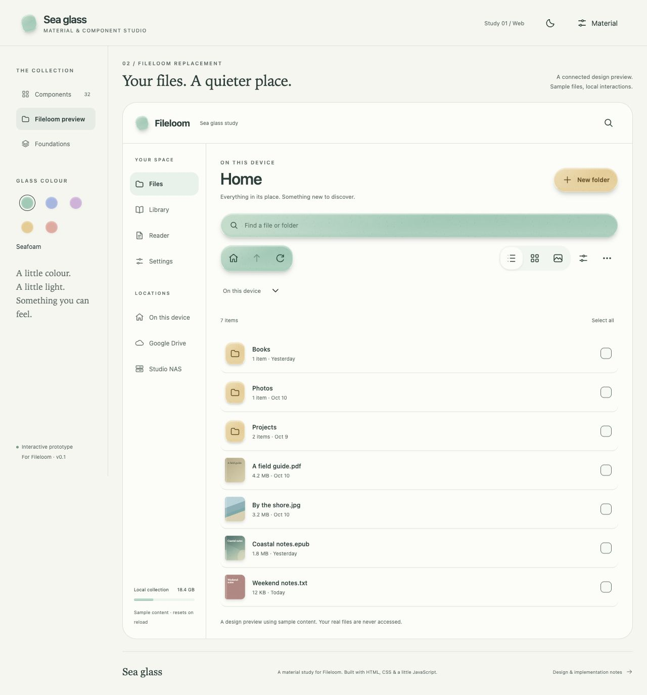

# Sea Glass · material & component studio

A standalone HTML/CSS/JavaScript prototype inspired by weathered sea glass. The material combines diffuse pigment, microscopic grain, rounded edges, edge illumination, and contact/cast shadows. No new dependencies, external fonts, analytics, or network services are used by the page.

## Open the studio

Requires Python 3.9+ to serve the preview. Node.js 20+ runs the tests. The page itself uses plain HTML, CSS and JavaScript, with no package installation or build step.

```sh
git clone https://github.com/beefiker/sea-glass.git
cd sea-glass
python3 serve.py --bind 127.0.0.1 --port 8786
```

Open `http://127.0.0.1:8786/` for the component studio, or add `#fileloom` for the connected app preview. The server allowlists only preview assets; it does not serve repository metadata or test scripts.

For access from your private Tailscale network, bind to the current host's Tailscale address:

```sh
python3 serve.py --bind "$(tailscale ip -4 | head -n 1)" --port 8786
```

On macOS, `bash start-preview.sh` starts a session-owned Tailscale preview and prints its verified URL. It runs until logout or reboot. Set `SEA_GLASS_PREVIEW_PORT` to use another port. Stop this helper with `launchctl remove io.sea-glass.preview`. Logs are written to `/tmp/sea-glass-preview.log`.



## Explore

- **Components:** 32 live component groups, covering buttons, icon actions, segmented control, slider, switches, checkboxes/radio, search/text input, stepper, select/menu, toolbar, badges/chips, progress, accordion, dialog, feedback, cards, and tooltips.
- **Fileloom preview:** connected Files, Library, Reader and Settings screens. Open folders; change list/grid/gallery; select, copy or move sample files; create folders and Library collections; adjust reader typography; find text; jump or scrub pages; reorder actions; edit tap zones; and move/pause/stop the playback pill. Open the printed tailnet URL with `#fileloom` to enter this view directly. All content and mutations stay in memory and reset on reload.
- **Foundations:** material anatomy, spacing, shape, motion, state and platform intent; default tokens download.
- **Material:** tune grain and depth, or use solid surfaces. Five pigment choices and two appearance modes. All demo state resets on reload.
- Press `/` to focus component search. Menus use Up/Down, Home/End and Escape. Dialogs use the browser's native focus boundary. Tooltips support hover/focus and Escape. Toast dismissal pauses under hover/focus.

## Files & material rules

`sea-glass.css` owns material rendering and responsive layouts. `.glass` is the shared layer; `.tone-*` changes pigment and foreground. Texture is an SVG tile under the content, rather than a filter over the entire control. `studio.js` owns primitive interactions. `fileloom-model.js` owns local fixtures and navigation/transfer/reader state; `fileloom.js` connects the app screens and 16 additional patterns; `fileloom.css` contains their scoped layouts. `motion.js` owns cancellable transitions. `tokens.json` records default cross-platform intent; tuning is exploratory and does not rewrite this file.

Use glass on actions and compact floating surfaces; keep document bodies and dense lists calm. Standard controls are 48 logical pixels, with 44 as the minimum hit target. Colour swatches have separate 44 px targets around their smaller visual marks. Disabled controls use real disabled semantics. Press, persistent selection, hover, and keyboard focus are separate. Reduced motion removes travel; forced colours retains borders and selection marks. The dark material uses a deeper body and light labels instead of reusing pale daylight surfaces.

Keep reflections strongest along the upper edge. The lower body retains its pigment, with a faint 0.04 edge light and 0.12 border alpha; avoid a white gradient band along the bottom. The lower edge stays subtle so the surface keeps its colour.

## Future Kotlin & Swift translation

This is a design specification prototype, not a native implementation or a claim of native validation. Kotlin/Compose and Swift/SwiftUI adaptations are future work.

Map logical pixels to Compose dp and iOS points; retain sp / Dynamic Type. Implement shared semantic roles (body pigment, on-material, edge light, focus, contact shadow) rather than copying CSS gradients literally. Use a tiny cached grain tile or shader on bounded surfaces; avoid per-control offscreen blur, dynamic texture generation, or expensive full-screen backdrop processing. A native performance spike must measure scrolling, touch feedback, contrast and accessibility before adoption.

Use each platform’s native or app-owned icon family. These preview icons are study illustrations. Preserve native OS sheets, pickers, navigation and gestures. Translate the visible Home / Up / Refresh intent to both platforms; history stays in More. Native selection must stay visible after the touch ends. Keep transient press feedback separate from persistent selection.

## Validation

Run the dependency-free contrast, cascade and HTTP checks:

```
python3 check.py --url http://TAILSCALE_IP:8786/
node --check studio.js
node --check motion.js
node --check fileloom.js
node --check fileloom-model.js
node --test motion-checks.mjs fileloom-checks.mjs
```

Browser observation checks accept captured DOM state from real browser interactions; they do not require a browser dependency. The CSS guard includes a negative case for generic icon buttons accidentally resetting the glass material. Token contrast includes a negative case for pale rose labels. Focus wrapping is explicit around the dialog's first/last controls because WebKit can insert a document focus stop. Screenshots are written outside the repository. These are focused preview checks; they are not an Android/iOS or full repository gate receipt. See `VALIDATION.md` for the observed run.

`browser-checks.mjs` contains the reusable assertions for browser observations. Collect initial focus, focus after three Tabs, focus after Shift+Tab, Escape/focus return, computed material backgrounds, target rectangles, and viewport width using real browser input and DOM inspection, then call `assertSeaGlassObservations`. Run its rejection fixtures with `node --input-type=module -e "import('./browser-checks.mjs').then(m=>console.log(m.checkNegativeFixture()))"`.

## Motion language

Sea Glass uses 160 ms for press/dismissal, 260 ms for state changes/overlay entrance, and 340 ms for disclosure/layout. A decelerating settle curve keeps surfaces responsive; a slight spring is reserved for the switch thumb and radio dot. Selection shares a moving highlight. Menus open from their trigger edge; dialogs lift 12 px and toasts rise 10 px. Removed tags fade a non-interactive copy while remaining tags glide into place. Material lighting and grain stay static.

Material → Reduce motion removes CSS and JavaScript animation and settles in-flight dismissals immediately. The OS reduced-motion preference takes priority. Each element/channel owns a cancellable animation: only the latest completion may hide a surface. Exiting menus/toasts become inert immediately. Disclosure returns to natural layout after settling. Modal focus remains inside until native close, then returns to its opener. Submission during exit is ignored to prevent duplicate sample-folder creation. Browsers without WAAPI reach the final state immediately.

Reference study (2026-10-13):

| Reference | Design input |
| --- | --- |
| [Transitions.dev](https://transitions.dev/) | Sliding tab highlight, origin-aware menus, modal scale, disclosure, toast entrance/exit and number changes described in its catalogue. |
| [UI Arc](https://uiarc.dev/) | Morphing controls and inbox gap continuity, adapted to selection and tag layout. |
| [Bencho](https://bencho.dev/) | Press, drag and select micro-interactions, including favourites and steppers. |
| [Audiocn](https://www.audiocn.dev/) | Continuous fader/knob controls: our range follows pointer input directly. |
| [Beautiful UI](https://www.beautifului.dev/) | Expandable traces and coherent contextual component states. |
| [BoardUI](https://www.boardui.com/) | Dense dashboard controls, filters, progress and selections. |
| [Termcn](https://www.termcn.dev/) | Compact terminal selects, alerts, badges and status components. |
| [23rd](https://23rd.dev/) | Browser-confirmed React/Svelte interactive pieces and shader backgrounds; decorative shaders remain future exploration. |

These are design references, not copied code or measured timings. Durations and easing are Sea Glass decisions. Native ports should translate the intent with Compose/SwiftUI animation, preserve OS presentations, and measure device rendering cost separately.

## Slider refinement

The slider uses a 44 × 28 px frosted capsule over a 12 px rounded track, inside a 48 px native input target. Grain and pigment follow the shared material settings. Upper-edge light stays restrained; the approved faint lower border remains. The thumb grows visually to 1.10 × 1.06 while held and settles with the shared 260 ms spring. Its layout size stays fixed, so deformation does not change the value mapping. Pointer movement, keyboard arrows and Home/End remain native and update the sample immediately. Reduced motion removes deformation and transitions, including the native browser thumb pseudo-elements. Forced colours uses system track/thumb colours and borders.

References: [Apple’s slider guidance](https://developer.apple.com/design/human-interface-guidelines/sliders) and [Build a UIKit app with the new design](https://developer.apple.com/videos/play/wwdc2025/284/). The pill profile and elastic interaction inform this adaptation; the material and exact geometry are Sea Glass decisions. No value momentum or delayed smoothing is added. The same slider styling serves Reading size, Surface grain and Elevation. Native ports remain future work.

## Fileloom patterns and prototype boundaries

The additional catalogue covers sheets, rows/tiles, location navigation, selection/transfer, adaptive destinations, precision controls, reading progress/page jump, reader bars, movable playback, grouped settings/choice cards, find results, recovery states, toolbar ordering, tap zones, command palette, and specialist layer/data views. See [COMPONENTS.md](COMPONENTS.md) for the component inventory and demo boundaries.

Try Files → select two files → Copy → Books → Copy here. Move is disabled at the source and rejects a folder inside itself or a descendant. Library → Collection creates a named group from chosen sample books without moving them. Projects contains the sortable table and layer-visibility examples. The command palette opens with Control/Command + K and can reach all preview states.

Reader settings have stepped size/spacing/rate sliders with endpoint-disabled minus/plus buttons. The reading scrubber only accepts a drag beginning on the thumb; track taps do nothing. Keyboard input and page-jump forms remain available. Draft scrubbing updates the percentage; release commits the page. Two-page layout uses columns on wide screens and collapses on phones. Reading-mode cards and tap zones describe configuration rather than implementing native pagination or gestures.

The reader always shows original sample text, including when entered through the PDF/TXT sample routes. Read-aloud controls demonstrate session states and movement; they do not synthesize audio. Provider destinations use local fixtures and make no network requests. Keep-screen-awake is a preview preference. No real documents, native parsers, permissions or accounts are used.

Modal underlay policy: do not replace the app page while a native dialog is open. Queue that render until the dialog close event, then restore focus to an available opener. This avoids leaving WebKit background controls inaccessible after a modal-driven page change. Pure style updates such as text size may update behind the sheet. Only actual navigation buttons participate in studio view bindings.

`fileloom-checks.mjs` guards navigation, transfer eligibility, independent copy identities, folder and collection validation, precise steps, seek preview/commit, ordering and server scope. `fileloom-browser-checks.mjs` asserts captured browser observations for 32 groups, unique IDs, compact targets, 320/390 px overflow, focus wrapping/return, repeated modal-driven renders, track-tap prevention and keyboard seek. Its negative fixtures reject the observed failure classes; they are not browser execution evidence on their own.
